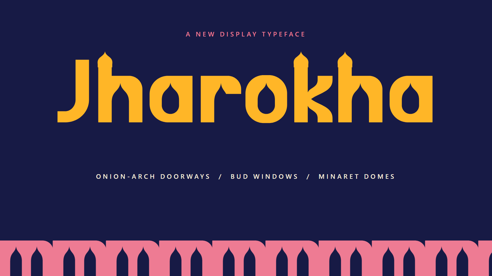
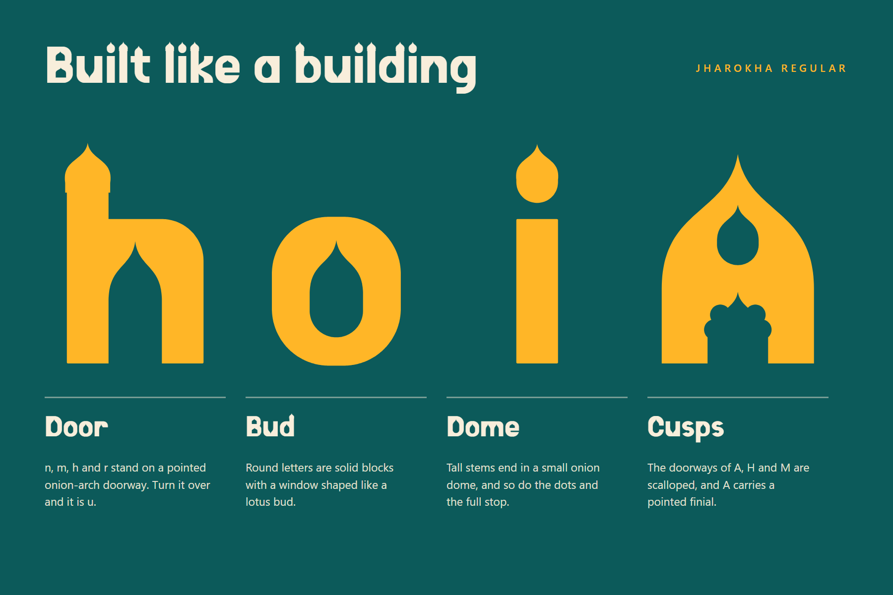
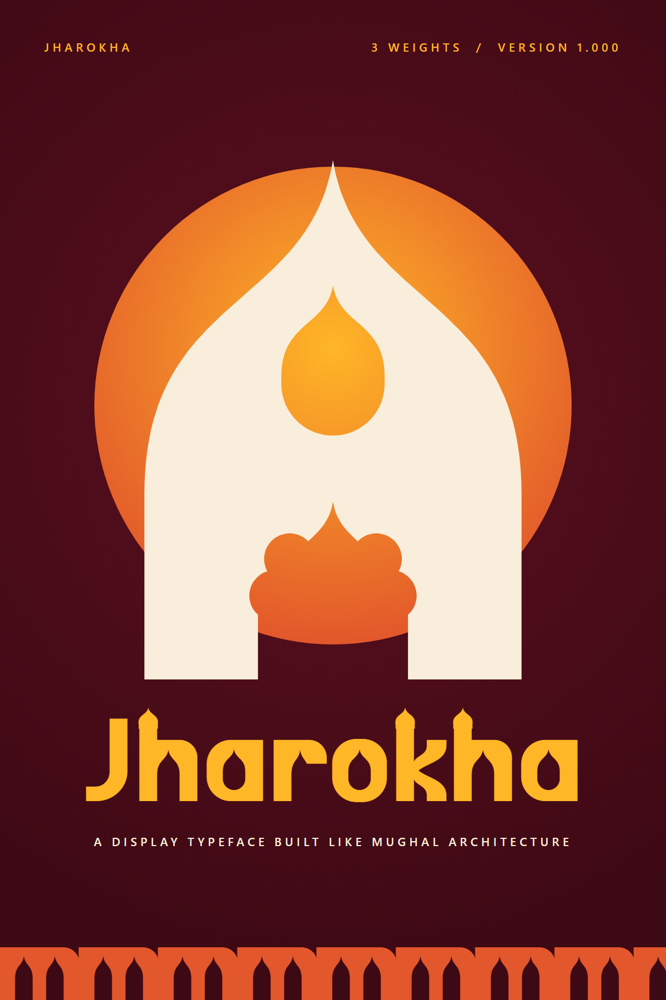
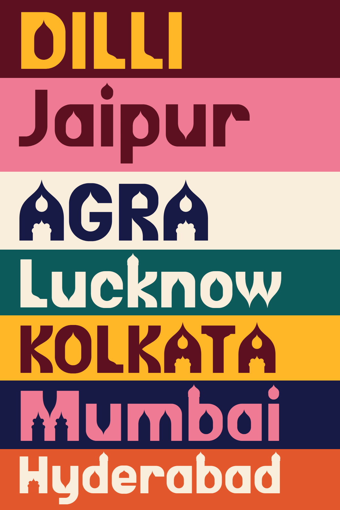

# Jharokha



Jharokha is a heavy display typeface. The letters are Latin, but they are built like Mughal and Rajasthani buildings: doorways with pointed arches, windows shaped like lotus buds, and little domes on top of the tall stems.

A jharokha is the stone balcony that hangs off the front of an old haveli or palace. The font borrows its parts from buildings like that, so the name felt right.

**Website:** https://orijitghosh.github.io/jharokha/ (you can type in it and try the font there)

**Download:** [Jharokha-1.000.zip](Jharokha-1.000.zip)

## Why I made it

I wanted an English font that feels Indian without doing the usual thing, which is hanging Latin letters from a Devanagari style bar. I tried that first, and a Bengali pen version before it, and both looked like a cliché. What worked in the end was not copying a script at all, but copying the architecture.

## How the letters work

Every letter starts as a solid block and then something gets cut out of it.

| Part | Letters | What happens |
|---|---|---|
| Door | n m h r u | The block stands on a pointed onion arch. u is the same thing upside down. |
| Bud | o a b d e g p q, most round capitals | The counter is a window shaped like a lotus bud. |
| Dome | b d h k l, i j, the full stop | Tall stems end in a small dome. Every dot is a dome. |
| Cusps | A H M | The doorway is scalloped. A also gets a pointed finial. |
| Bracket | E F L T | A small curved bracket sits where a bar meets the stem. |

V, W, X, K and Y are made from the same arch turned upside down.



## What is in the font

210 glyphs in one weight:

- A to Z, a to z, figures, punctuation
- the rupee sign
- accents for most Western European languages
- the letters used to write Sanskrit and other Indian languages in Latin script (ā ī ū ṛ ṝ ḷ ṅ ñ ṭ ḍ ṇ ś ṣ ḥ ṁ ṃ)
- a few Central European letters (ć č ń š ş ź ż ž)

Not there yet: æ, œ, ß, ð, þ. Accented letters are not kerned. There is only one weight.

It is meant for big sizes. Below about 24 px the small windows start to close up.

## Posters

<p>



</p>

Full-size specimen posters are in [promo/](promo/).

## Building it yourself

The letters are not drawn in a font editor. Each one is written as geometry in Python and the font file is generated from that. You need Python 3.10 or newer.

```
pip install fonttools shapely pillow
python make.py
```

That writes the font to `fonts/`, proof sheets to `proofs/`, and the download zip.

To test a few words quickly:

```
python make.py "Namaste Dilli" "Chai & chaat"
```

and look at `proofs/proof.png`.

The posters are made with `python promo.py`. That one needs Chrome or Edge installed, because it lays each poster out as a web page and takes a picture of it.

| File | What it does |
|---|---|
| `engine.py` | Shapes: rounded boxes, the onion arch, strokes |
| `letters.py` | Every base letter, figure and symbol |
| `accents.py` | Accented letters, put together from a base letter and marks |
| `build.py` | Turns the shapes into a TrueType font |
| `make.py` | Runs the build, adds kerning, writes proofs and the zip |
| `promo.py` | Specimen posters and banner |

If you want to change a letter, find it in `letters.py`. Most of them are only a few lines.

## Licence

SIL Open Font License 1.1, see [OFL.txt](OFL.txt). You can use the font for anything, including commercial work, and you can modify and share it. It has to stay under the same licence and it cannot be sold on its own.

Designed by Arijit Ghosh.
